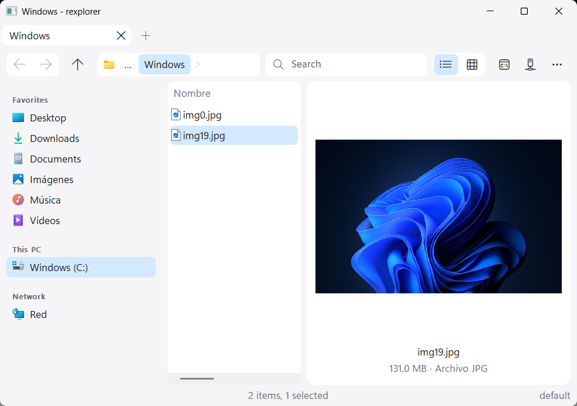
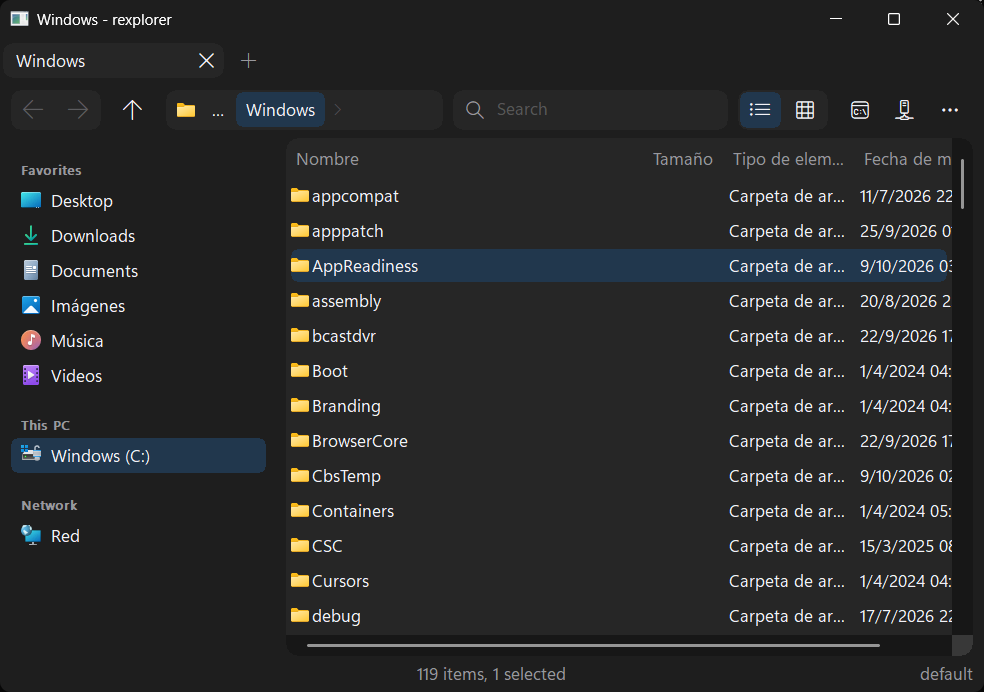
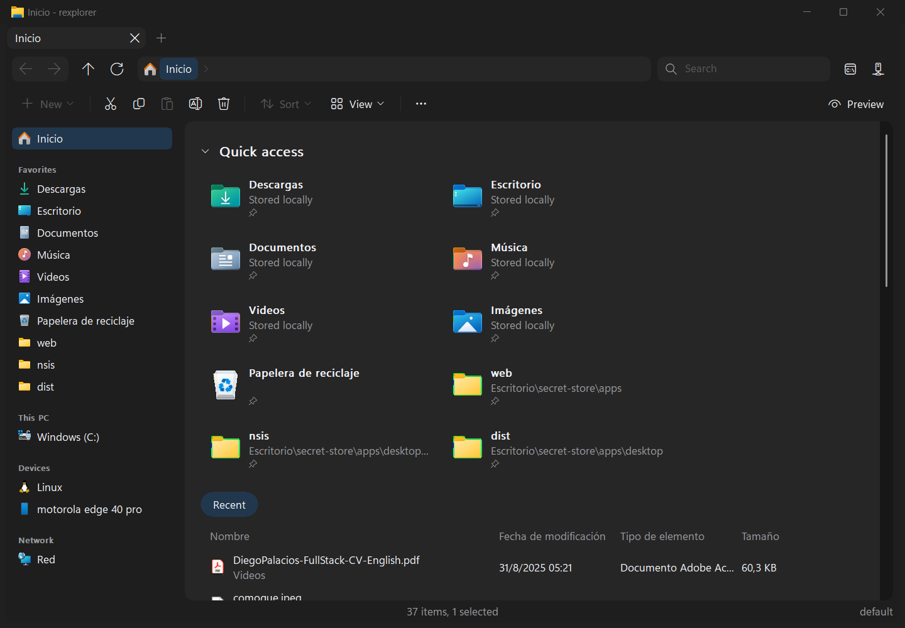

# rexplorer

A Windows file manager in Rust that hosts the Windows shell namespace and renders it with plain Win32
controls. Fast on the common path, delegates everything else to the shell, and falls back to Windows
Explorer (embedded in the window) for folders it cannot list.

Layout:

- `crates/core`: headless shell layer (folders, items, menus, notifications). Tested against the real shell.
- `crates/app`: the Win32 window. No logic beyond plumbing.

```
cargo test -p rexplorer-core
cargo run --release
cargo run --release -p rexplorer-core --example bench -- <folder>
```

## Phase 0 result: enumeration through the shell is fast enough

Folder of 100,000 files in `%TEMP%\rexplorer-bench`, release build, warm cache, 2026-10-09:

| Step | Time |
|---|---|
| `IShellFolder::EnumObjects`, all 100k PIDLs | 130–150 ms |
| Display names for all 100k (the list only needs visible rows) | 46 ms |
| Attributes (folder flag) for all 100k | 31 ms |
| Sort with `CompareIDs` | 66–69 ms |
| Floor: .NET `Directory.GetFileSystemEntries` | 93 ms |
| PowerShell `Get-ChildItem` for scale | 2052 ms |

Decision: keep pure shell enumeration for every folder type. No filesystem fast path.

## Features (Phase 1 and Phase 2 through step 8)

Everything shown is a shell item: names, columns, icons, sorting, context menus, file operations, rename, live
updates and drag and drop all come from the shell. rexplorer draws; the shell does the work.

### Look





In the spirit of GNOME Files and the macOS Finder: one flat header bar, a sidebar of places, pill-shaped path and
controls, the list and the preview in rounded cards, no 1 px borders. The frame, tab strip, header, sidebar and
status bar share the theme's `background`; cards and fields use its `surface`; selections are `selection` pills.
The system title bar takes the `background` color, so it reads as part of the header.
The cards' corners (the list, the Home page, the preview) are painted antialiased in the frame color, with 4x4
samples per pixel, at 10 px scaled to the DPI; the scroll bars' corners too. The embedded Explorer view and the
command palette keep a plain GDI window region.

### Window

Top to bottom: a tab strip of pill-shaped tabs; a 44 px header bar (a Back / Forward segment, Up, Refresh, the
path bar, a 220 px search field, Terminal, Connect); a 44 px command bar (below); the places sidebar beside the
list card (or the Home page) and the preview card; a status bar (centered item and selection counts, search progress; the profile on the
right). The 8 px gaps between the left pane and the cards are splitters (drag to resize, 120 to 600 px). The window
follows the theme (title bar color, Mica when the theme asks for it, themed list, header, Edits and fonts that follow
the monitor DPI). Minimum size 640x400.

Sidebar, every row read from the shell with its localized name and icon:

- **Home** ("Inicio" on a Spanish Windows) on top, without a section title.
- **Favorites**: the profile's bookmarks, then the folders of Quick Access in the shell's order: the pinned known
  folders, the Recycle Bin, your own pins and the frequent folders. A place is listed once.
- **This PC**: the drives, connected MTP phones and other devices This PC shows (not the user folders it also
  lists).
- **Devices**: what the desktop root adds that is neither a file on the desktop nor a place shown elsewhere: Phone
  Link phones (`%USERPROFILE%\CrossDevice\...`) and Linux (WSL). Left out when empty.
- **Cloud**: the cloud-sync roots found on this machine (OneDrive, Google Drive, Dropbox, iCloud Drive); left out
  when there are none.
- **Network**.

Click a row to go there; the row of the current folder, or of its nearest ancestor, is highlighted. Right-click a
pinned Quick Access folder for **Unpin from Home**, a frequent (not pinned) one for **Pin to Home**, a bookmark for
**Remove bookmark** (its `bookmark.<label>` line leaves settings.ini). Pinned and frequent are told apart by the
shell's `System.Home.IsPinned` property. The rows are built on a worker thread, rebuilt when the window is activated, every 30 s while the sidebar shows, when a drive comes or goes, and right after
a pin or unpin from rexplorer, so the sidebar fills in after the first listing. More > **Folder tree** shows the
shell's folder tree in the sidebar's place (choose it again for the sidebar).

The folder background's right-click menu opens as Explorer's does: **View** and **Sort by** submenus, **Refresh**,
**Paste** (enabled with files on the clipboard) and **Pin to Home**, each with its command-bar glyph, then the
shell's own entries (Open in Terminal, the editors' "Open with", Give access to, New, Properties).

Pins: **Ctrl+D**, **Pin to Home** at the top of the list's context menu, or More > **Pin to Home** run the shell's
own "pin to Home" verb on the selected folders, or on the current folder when nothing is selected. The pin lands
in Explorer's Quick Access too, and unpinning from either side shows in both.

Loading: a navigation shows where it goes at once. The title, tab, path bar and sidebar take the destination's
name, the status bar reads "Loading…", and when the folder takes longer than 120 ms the list shows eight pulsing
placeholder rows until it arrives (a slow Network folder, a sleeping drive). Fast folders never flash. A refresh
keeps the current items on screen. If the place cannot be opened, the previous one comes back with the error. A
search shows the same placeholders, with "Searching…", until its first result.

Path bar: click a crumb to go there (the current folder, the last crumb, refreshes), its chevron lists the
subfolders (drive paths, UNC paths and This PC), a click on the empty area turns it into an address Edit (a path,
a `shell:` name, a `::{CLSID}` or a path inside a .rar).

Command bar, as in Windows 11 Explorer: **New** v (Folder, which is created and then renamed in place, then the
shell's own New submenu: shortcut, text document and so on) | **Cut**, **Copy**, **Paste**, **Rename**, **Share**, **Delete**
| **Sort** v (the listing's columns, the active one checked, then Ascending / Descending), **View** v (Details,
Icons, Thumbnails, then Sidebar, Folder tree and Preview pane, all with checks) | **More** (...), and on the right
a **Preview** toggle. The buttons are enabled from the current state and update on a selection change, a tab
switch, the end of a load and a clipboard change: Cut and Rename need a shell folder (Rename exactly one item),
Copy and Delete also work on search results, Paste needs files on the clipboard, New and Sort are off on Home,
Share needs a selection in a shell folder or on Home. Share opens the Windows share sheet over the window for the
selected files (through `IDataTransferManagerInterop`; the shell's own "Windows.ModernShare" verb refuses a
desktop window); folders cannot be shared, as in Explorer, and a selection without files beeps.
Delete with Shift deletes permanently, as in the list. Cut, Copy, Paste, Rename and Delete run the shell's own
verbs. The old list / grid view segment is gone: the views are in View v and on Ctrl+Shift+1/2/3.

Home page: Home and Quick Access open a page of their own in the list's place, drawn like Explorer's: a "Quick
access" title, a responsive grid of 280x72 folder tiles (as many columns as fit, re-flowed on resize and DPI change) (40 px icon, name, the parent folder relative to the
profile, a pin glyph on pinned folders only), three pills and a table of files (icon, name with its folder
below, Date modified, Type, Size, and Activity when the shell has any, e.g. "X edited this" on cloud files; column
titles from the shell, so localized), newest access first. The pills filter the table: **Recent** (the recent
files), **Favorites** (files added to Favorites) and **Shared** (files shared with you, the shell's "shared"
group); each tab keeps its own pill (not saved). Empty tables read "No recent files", "No favorites yet" or
"Nothing shared with you". A file the shell lists in two groups (recent and a favorite) is one row with both. It scrolls (wheel and
scroll bar) and follows the theme and the DPI. Hover, click (Ctrl+click toggles), double-click or Enter opens;
right-click shows the shell's context menu, with **Unpin from Home** on pinned tiles and **Pin to Home** on
frequent ones (the shell's own entries, such as add to or remove from Favorites, refresh the page); right-click on empty
space (or Shift+F10 / the Menu key with nothing selected) shows Home's own menu: Refresh, **Show recently used files** and
**Show frequently used folders** (ticked toggles; they flip the Folder options keys live and in settings.ini) and
**Folder options...**; Left / Right step one entry, Up / Down move a whole row of tiles, PageUp / PageDown a page, Home / End,
Ctrl+A selects the rows, Delete deletes, F5 refreshes, F2 renames in place. The status bar, the preview pane and
the command bar follow its selection. While Home loads,
the list's placeholder rows show as for any folder.

More menu: Folder tree, Pin to Home, Open in Explorer, register / unregister as the folder handler, **Install as
default file manager...** and **Uninstall...** (each asks first, listing what changes; see below), the settings
folder, About, and **Quick access**: the profile's bookmarks and the cloud-sync roots.

**Folder options...** (More menu) is a themed tabbed dialog with OK, Cancel and Apply. General: the start folder (Home,
This PC or the profile's own), single or double click to open with the underline choice (`underline_titles`), Home's
Privacy switches (`show_recent`, `show_frequent`) and a Clear button for the Ctrl+P recent folders list (rexplorer's own
`recent.txt`; Windows' Recent folder is never touched). View: hidden files, hide extensions (folder lists and search results alike; ZIP and CAB files count as files, and a
rename keeps the hidden extension), status bar
(`show_status`), shell preview handlers in the preview pane (`preview_handlers`), check boxes to select items
(`item_checkboxes`), and the search and hover-preview delays (clamped to 50..5000 and 200..10000 ms). Search: whether a
walk of a non-indexed place enters system folders (`search_system`) and archives such as ZIP and CAB (`search_archives`).
Every change is written to the active profile in settings.ini and applies at once; Restore defaults resets one tab.

### What a tab can show

- **A shell folder**: filesystem, virtual (This PC, Recycle Bin, Control Panel...), zip files (the shell browses
  them as folders), network shares, `ftp://` URLs where the shell supports them. A filesystem folder the shell
  lists as empty but Windows refuses to read (`C:\System Volume Information`) says so in the status bar: "Access
  denied: <the error> (Ctrl+Shift+E opens it in Explorer)".
- **Home**, where a first run starts: the shell's own Home folder, so the pinned folders (above, as folders sort
  first) and the recent files, with the shell's columns. Enter on a recent file opens it with its default verb; Up
  goes to This PC.
- **A .rar archive**: Enter on a .rar file, or type a path to it or inside it (`C:\x\a.rar\docs`). Columns
  Name, Date modified, Type, Size; directories first. Enter on a directory enters it, Backspace / Alt+Up goes up
  (at the archive's root: back to its folder), Enter on a file extracts it to
  `%TEMP%\rexplorer-archive\<hash>\` (cached per archive and modification time) and opens it with its default
  app. Right-click: **Extract all to...** (folder picker) or **Extract here** (the archive's folder). Archives
  are read-only: no rename, delete or drop. The archive is listed on a worker thread.
- **Search results**: type in the search box and press Enter (Ctrl+F focuses it). The search walks the current
  folder and every subfolder on a worker thread (archives, links and hidden `C:\$...` folders are skipped);
  results stream into the list as each folder finishes, with columns Name, Folder, Type, Size. The tab and
  window title read `Search: <text>`. Escape stops the search and keeps what it found; F5 runs it again;
  navigating anywhere stops it. When rexplorer runs elevated (`rexplorer --elevated` from an admin console; an
  elevated start without the flag restarts itself unelevated, as Explorer never shows an elevated folder window)
  and the folder is a drive root, the drive's NTFS index (read once per drive from the MFT, then kept for the
  session) answers instead, up to 5000 results.
  Enter on a result opens it (folders and .rar files in place); the context menu, Delete and Ctrl+C / Ctrl+X
  work on results that share one folder.
- **The embedded Explorer view**: a folder that exists but cannot be listed (a phone, an odd namespace
  extension) opens in an Explorer view hosted in place of the list. The breadcrumb, title and address follow
  it; navigating inside it to a folder the list can show brings the list back, as does going anywhere else.
  Ctrl+Shift+E still opens real Explorer. A name that does not resolve shows an error.

### Keys

| Keys | Action |
|---|---|
| Enter, double-click | Open folder, archive or archive directory in place; open a file with its default verb |
| Backspace, Alt+Up | Up (folder, archive directory, archive's folder, or the searched folder) |
| Alt+Left / Alt+Right, mouse back / forward buttons | Back, forward |
| F5, Ctrl+R | Refresh (a search runs again) |
| Ctrl+L, Alt+D | Edit the address over the breadcrumb |
| Ctrl+F | Search box (Enter searches, Escape stops and returns to the list) |
| Escape (list) | Stop a running search |
| F2, Delete, Shift+Delete, Ctrl+C/X/V, Ctrl+A, Alt+Enter | Shell verbs on the selection (F2 on shell items only) |
| Right-click | Full shell context menu (Shift adds the extended verbs); the background adds View, Sort by, Refresh, Paste, Pin on top; archives get the extract menu |
| Ctrl+Shift+E | Open the current folder in Windows Explorer (an archive: its folder) |
| Ctrl+T, Ctrl+W | New tab at the start place, close tab (closing the last tab closes the window) |
| Ctrl+Tab, Ctrl+Shift+Tab, Ctrl+1..8, Ctrl+9 | Next, previous, nth, last tab |
| Middle-click a folder | Open it in a background tab (middle-click a tab closes it) |
| Ctrl+P | Palette: recent places, bookmarks, cloud roots and the current subfolders, fuzzy matched |
| Ctrl+D | Pin the selected folders (or the current folder) to Home |
| Right-click a sidebar row | Unpin from Home (Quick Access folders), Remove bookmark (bookmarks) |
| Ctrl+` | Terminal (Windows Terminal, else cmd) in the current filesystem folder |
| Ctrl+B | Show / hide the sidebar (hides the folder tree when that is showing instead) |
| Alt+P | Show / hide the preview pane (text in a monospace Edit, preview handlers in place, else a thumbnail) |
| Ctrl+Shift+1 / 2 / 3, View menu | Details / icons (96 px) / thumbnails (128 px) |
| Connect button | FTP dialog (host, port, user, password, path); the `ftp://` URL opens in a new tab |

Shortcuts work while the tree, the search box or the embedded Explorer view has the focus, except Enter and
Escape, which those keep.

They can be rebound in a `[keys]` section of `settings.ini`: one line per command, `cmd.new_tab=Ctrl+Y` or
several chords `cmd.back=Alt+Left, Backspace`. Commands: `cmd.back`, `cmd.forward`, `cmd.up`, `cmd.refresh`,
`cmd.address`, `cmd.explorer`, `cmd.enter`, `cmd.escape`, `cmd.properties`, `cmd.new_tab`, `cmd.close_tab`,
`cmd.next_tab`, `cmd.prev_tab`, `cmd.palette`, `cmd.terminal`, `cmd.toggle_sidebar`, `cmd.toggle_preview`,
`cmd.search`, `cmd.pin`, `cmd.view_details`, `cmd.view_icons`, `cmd.view_thumbnails`. A chord is `Ctrl`, `Alt`,
`Shift` in any combination plus a key: a letter, digit or backquote (these need Ctrl or Alt, so typing keeps
working), `F1`..`F24`, `Left`, `Right`, `Up`, `Down`, `Enter`, `Esc`, `Tab`, `Space`, `Backspace`, `Delete`,
`Insert`, `Home`, `End`, `PageUp`, `PageDown`. A command whose line has no valid chord keeps its defaults.

Icon and thumbnail images render on a worker thread and land as they finish; the last 512 are cached. In both
icon views and in the preview pane a folder shows the shell's composed thumbnail, as Explorer's: the folder with a
peek at a file inside (a picture strip, a document sheet; the shell picks the file). Drag items
out of the list to anywhere that accepts files, or drop files onto a folder item or the list background.

### Command line

```
rexplorer [options] [folder...]
  --select <path>     open the parent folder with <path> selected (also /select,<path>)
  --profile <name>    use the named settings profile
  --new-tab, -t       open in a new tab of the running window
  --search <text>     search the (first) folder opened for <text>
  --register          open folders and Win+E with this exe (per-user HKCU\Software\Classes keys; asks first)
  --unregister        undo --register
  --install           copy rexplorer to %LOCALAPPDATA%\Programs and make it the default file manager
  --uninstall         undo --install
  --import-explorer   copy Windows Explorer's settings into the active profile (backs up settings.ini)
  --overwrite         with --import-explorer: also replace values you changed in rexplorer
  --recover           restore the previous session after a crash
  --desktop           run the helper that shows rexplorer's context menu on the desktop (install starts it)
  --elevated          when started elevated, stay so (drive-wide indexed search) instead of restarting unelevated
  -h, --help          show this help
```

Folders may be paths, `shell:` names, `::{CLSID}` strings, UNC paths or .rar paths. Explorer's own arguments
work too, since an installed rexplorer is started as `explorer.exe`: `/select,<path>` (also `/select,` followed by
the path as the next argument), `/e,<path>`, `/root,<path>`, `/n`, `/separate`, chained with commas
(`/n,/e,/select,C:\x`); a file path opens its folder with the file selected (.zip and .rar files open as folders); a
trailing backslash, or the trailing quote some callers leave (`"C:\"` arrives as `C:"`), is dropped. Anything
else Explorer-style (`/idlist,...`, an unknown `/` switch, URLs such as `ms-settings:display`,
`shell:AppsFolder\<app>`) is handed verbatim to `C:\Windows\explorer.exe` (with CreateProcess, never through App
Paths) and the process exits. A second launch hands its folders (and `--search`) to the running window and
exits (36-78 ms measured from process creation to the new tab's title); a second launch without folders (Win+E once
installed) opens a tab at the profile's start place. One instance runs per settings folder, so a launch with
another `%APPDATA%` (the smoke test) runs on its own. A plain first launch opens a tab at the start place, as
Explorer does (view and panes still come from the session); a launch with folders opens just those. After a crash
the process relaunches itself with `--recover`; each `--recover` start
counts itself in `%APPDATA%\rexplorer\crash-count.txt`, and the second within 60 s opens the folder in Windows
Explorer instead of running (so a crash loop stops at Explorer). A start without `--recover` resets the count.
Ctrl+Shift+E and the fallbacks start `%SystemRoot%\explorer.exe` by full path, so they reach Explorer even when
rexplorer answers for `explorer.exe`.

### Install

Option A, the script (no administrator prompt: rexplorer installs per user, under `HKCU` and `%LOCALAPPDATA%`, and
running it elevated would only hand user-writable files rights they should not have):

```
powershell -ExecutionPolicy Bypass -File scripts\install.ps1
```

It builds `target\release\rexplorer.exe` if missing, runs `rexplorer.exe --install` (which warns first that it
replaces Explorer and any running rexplorer, and offers Roll back if it fails), then asks whether to import your
Windows Explorer settings (Y/n, default Y; `-ImportExplorer` answers yes and `-NoImport` no, without asking) and ends
with where rexplorer is installed, how to start it and how to uninstall. `-Exe <path>` installs another build;
`-Uninstall` reverts.

The import is `rexplorer.exe --import-explorer [--overwrite]`, which you can run any time. It only reads Explorer's
values and sets these keys of the active profile in `settings.ini` (comments, line endings and spacing kept; a key
already there changes in place, a new one goes to the top of the profile's section):

| Explorer value | rexplorer key |
|---|---|
| `Advanced\Hidden` (1 show, 2 do not) | `show_hidden` |
| `Advanced\HideFileExt` | `show_extensions` (inverted) |
| `Advanced\ShowStatusBar` | `show_status` |
| `Advanced\ShowPreviewHandlers` | `preview_handlers` |
| `Advanced\AutoCheckSelect` | `item_checkboxes` |
| `Advanced\LaunchTo` (1 This PC, 2 Home, 3 Downloads) | `start` |
| `ShowRecent`, `ShowFrequent` | `show_recent`, `show_frequent` |
| `ShellState` flag "double-click to open" | `single_click` (when it is off) |

A value Windows has not written (common: LaunchTo, ShowPreviewHandlers, ShowRecent) imports nothing. A key is only
set while the profile still has rexplorer's default for it; `--overwrite` replaces the others too. Before the first
change it copies `settings.ini` to `settings.ini.bak-<yyyy-mm-dd>` (`-2`, `-3`... when that
name exists, so an earlier backup is never overwritten or reused), and a message box lists what was imported, what
was skipped and why, and the backup file it wrote. If the backup or the write fails, it says so and exits with code 1. Uninstalling does not undo an import: your
settings stay.

Option B, a terminal, no elevation:

```
cargo build --release
target\release\rexplorer.exe --install
```

Uninstall: `powershell -ExecutionPolicy Bypass -File scripts\install.ps1 -Uninstall`, or
`%LOCALAPPDATA%\Programs\rexplorer\rexplorer.exe --uninstall`, or More > **Uninstall...**.

What it changes is listed in the next section. The taskbar and the Start menu stay Explorer's (Start only gains a
rexplorer shortcut), and Explorer keeps drawing the desktop: only the desktop's right-click menu becomes rexplorer's. To go back
to Explorer, uninstall; if rexplorer will not start, run `C:\Windows\explorer.exe` and use Win+R to run the uninstall
command above.

### Make it the default file manager

`rexplorer --install` (or More > **Install as default file manager...**) copies the running exe to
`%LOCALAPPDATA%\Programs\rexplorer\rexplorer.exe` and points Windows' entry points for folder windows at that copy.
It replaces Explorer's folder windows and the desktop's right-click menu: the desktop itself, the taskbar and the
Start menu stay Explorer.

| Entry point | After `--install` | How |
|---|---|---|
| Opening a folder or drive from the desktop, a shortcut, another program's "open folder" (`ShellExecute` of a folder) | rexplorer | `HKCU\Software\Classes\{Folder, Directory, Drive}\shell\open\command` = `"<copy>" "%1"` |
| Win+E, the taskbar's File Explorer icon, Start's "File Explorer" | rexplorer, at the start place (Home) | `HKCU\Software\Classes\CLSID\{52205fd8-5dfb-447d-801a-d0b52f2e83e1}\shell\{open, opennewwindow}\command` = `"<copy>"` |
| Programs that run `explorer.exe` by bare name through `ShellExecute` (`explorer.exe /select,<file>`, `explorer.exe <folder>`) | rexplorer, with the arguments above | `HKCU\Software\Microsoft\Windows\CurrentVersion\App Paths\explorer.exe` = the copy, `Path` = its folder |
| Start menu | a "rexplorer" shortcut | `<Start Menu>\Programs\rexplorer.lnk` |
| Right-click on the desktop | rexplorer's menu | `<Startup>\rexplorer desktop menu.lnk` runs `rexplorer --desktop` at sign-in; install also starts it |
| Programs that start `C:\Windows\explorer.exe` with `CreateProcess`, or call `SHOpenFolderAndSelectItems` (Chrome-style "Show in folder") | still Explorer | not reachable per-user |
| The desktop itself (icons, wallpaper, keyboard menus), the taskbar, Start, other programs' Open / Save dialogs, Explorer windows already open | still Explorer | untouched |

Each command key also gets an empty `DelegateExecute` value, which stops Windows from using Explorer's own handler.
`--install` refuses, changing nothing, when another program already overrides one of these keys. Everything it
created (keys, values, the copy, the shortcut) is listed in `%LOCALAPPDATA%\Programs\rexplorer\install.txt`.
Running it again updates the copy (a running copy is renamed to `rexplorer.old`, deleted at the next start).
Every install first warns that it replaces Explorer and any running rexplorer copy, and exits with code 2 if you
answer No. If an install fails partway, a dialog offers **Roll back**, which restores every value, key and file it
had changed to what was there before, or **Keep changes**, which you can still undo with `--uninstall`.

Escape hatch: `rexplorer --uninstall` (or More > **Uninstall...**, or `%LOCALAPPDATA%\Programs\rexplorer\rexplorer.exe
--uninstall` from Win+R) reverts what install.txt lists: the values that still name rexplorer (a value another
program has written since is left alone), the keys install created once they are empty, the shortcut, then the
copy (if it is running it moves to `%TEMP%`, deleted at the next start). Both print a summary in a message box
and exit 0, or non-zero on an error. If rexplorer keeps crashing, the crash guard above opens Explorer.

Nothing touches HKLM and nothing needs elevation: all of it is per-user under HKCU and `%LOCALAPPDATA%`.
`--register` / `--unregister` remain the registry-only subset: they point the five command keys at the exe they run
from, without copying it, without App Paths and without a shortcut.

### The desktop menu

Explorer is the Windows shell (taskbar, Start, desktop) and keeps running: rexplorer never replaces that process.
`rexplorer --desktop` is a small helper (one per sign-in) with a low-level mouse hook. A right-click that lands on
the desktop's icon list is taken from Explorer and answered with rexplorer's menu, built like the file list's: on
an icon, the shell's verbs for the selection (an unselected icon is selected first, a selected one keeps the
selection, as in Explorer); on the background, View (icon sizes, Auto arrange, Align to grid), Sort by, Refresh and
Paste, then the shell's background verbs (New, Display settings, Personalize and installed extensions). Shift+right-click
adds the extended verbs. Everything else, a right-click on any other window included, passes through untouched.

The helper reaches Explorer's desktop view through `IShellWindows` (as Explorer's own tools do) and reads the icon
under the cursor through the list's accessibility object. Uninstall closes it and removes the Startup shortcut. To
turn it off without uninstalling, delete `rexplorer desktop menu.lnk` from the Startup folder (`shell:startup`) and
end `rexplorer.exe --desktop`. Not covered: right-dragging desktop icons (the press goes to the menu), and Shift+F10 /
the Menu key on the desktop, which still open Explorer's menu.

### Files under `%APPDATA%\rexplorer`

`settings.ini` and `themes\*.ini` are written with defaults on first run, then yours to edit. A new profile has
no bookmarks (Quick Access already brings the known folders); one written by an earlier version keeps its start
folder and its Desktop / Downloads / Documents bookmarks (right-click them in the sidebar to remove them). Where
Home does not exist (older Windows), the default start is This PC. Lines starting with `;` or `#` are comments.

```ini
[general]
profile=default                  ; the active profile

[profile default]
start=shell:::{F874310E-B6B7-47DC-BC84-B9E6B38F5903}   ; where a launch without folders, and a new tab, start: Home
theme=dark                       ; a file name in themes\ without .ini
view=details                     ; details | icons | thumbnails (the view segment writes it back here)
show_tree=false                  ; the folder tree instead of the sidebar
show_preview=false
tree_width=220                   ; sidebar (or tree) width, 96-DPI pixels
preview_width=360
bookmark.Repos=C:\src           ; bookmark.<label>=<target>: sidebar Favorites, palette, More > Quick access
```

`themes\<name>.ini` holds one `[theme]` section; missing keys fall back to the built-in dark or light theme
chosen by `dark` (the built-in dark theme shown):

```ini
[theme]
dark=true
mica=true                        ; Mica backdrop where Windows supports it
background=#1E1E1E               ; colors are #RRGGBB; the frame: tabs, header, sidebar, status bar, title bar
surface=#262626                  ; cards and fields: the list, the preview, the path bar, the search field
text=#F2F2F7
secondary_text=#98989D           ; section titles, column titles, the status bar, chevrons
accent=#0A84FF
selection=#21374D                ; selection pills (the built-ins mix 18% accent into the surface)
border=#2F2F2F                   ; kept for themes; nothing draws border lines any more
icon_theme=default               ; optional: a folder under icons\
font=Segoe UI Variable Text
font_size=10                     ; points
```

The built-in light theme is `background=#F5F5F7`, `surface=#FFFFFF`, `text=#1D1D1F`, `secondary_text=#6E6E73`,
`accent=#0A84FF`, `selection=#D3E9FF`. A theme file without `surface` but with `background` uses the background for
the cards (flat, as before). A `light.ini` / `dark.ini` still holding an earlier version's unedited defaults is
rewritten with the current ones at startup; edited files are left alone.

Icon themes: `icons\<name>\` holds PNGs named by extension (`rs.png`, `pdf.png`...) plus `folder.png` and
`file.png` (the fallback for unknown extensions); the details view draws them, at the small-icon size, instead of
the system icons, for folders, archive members and search results alike. A folder whose name ends in a themed
extension (a zip, a folder to the shell) gets that extension's PNG. PNGs are decoded on first use, so a theme of
hundreds costs nothing at startup. `icons\default` is written on first run: `folder.png` and `file.png` in the
theme's accent. Only while a theme sets `icon_theme=default`, the app also exports, in the background (about ten
seconds), Windows' own 48 px icon for every extension registered on the machine that has an icon of its own (about
560 here; `system-icons.txt` lists them and marks the export done; delete it to pick up extensions registered
since). The export never overwrites a PNG, so edit or replace any.

Opening-app icons: a file type Windows registers without an icon of its own shows Explorer's blank page (`.ps1` on
a machine whose PowerShell file type was never registered, `.py` or `.md` opened with an editor that registers no
icon). rexplorer shows the icon of the app that opens it instead, as Finder and Nautilus do, in every view, in search
and archive rows and in the exported theme. The app comes from the shell's "open" association; a registered path
that no longer exists (a WinSxS copy removed by a Windows update) is searched by name on PATH. A type with neither
an icon nor an opener keeps the blank page.

Written by the app: `session.txt` (`tab=` lines, `active=`, `view=`, `tree=` / `sidebar=` / `preview=` as 0 or 1,
the pane widths; saved within 2 s of each change and on exit; a search tab is saved as its folder), `recent.txt`
(palette history), `window.txt` (placement). A first run, or `--profile`, takes view and panes from the profile;
later runs from the session. A session written before the sidebar existed (no `sidebar=`) opens with the sidebar.

The exe carries a Common Controls 6 manifest (`crates/app/build.rs`): icon views and the themed controls need it.
It also carries Windows Explorer's own icon, so the taskbar and the title bar look like Explorer's: `scripts/extract-icon.py` copies the
first icon group of `C:\Windows\explorer.exe` into `crates/app/app.ico` (Microsoft's artwork, for personal use), and `build.rs` compiles
`app.rc` with the newest Windows SDK `rc.exe` it finds and links the result. Without the SDK the build warns and skips the icon.

### Smoke test

`scripts\smoke.ps1` drives the release exe: startup, the 100k-file folder (`%TEMP%\rexplorer-bench`, populated
in about 300 ms from process start), columns, keyboard navigation, live update, the not-found fallback (error,
no Explorer window), the Explorer hotkey, tabs, the single-instance hand-off, first-run settings, `--help`,
placement, the tree (opened from More > Folder tree), the preview, the views, a RAR5 archive (open, enter a
directory, go back up), a search in the 100k folder (typed into the search box), `--search` from the command line,
the look (the sidebar is there, the list card's corner pixels are the frame color and its inside is not, a click
on the Downloads row navigates, Ctrl+B hides the sidebar), Home (a first run without folders shows it, and it is the sidebar's first row), the
shell-built sidebar (a Recycle Bin row in Favorites, a C:\ row under This PC), the loading state (a click on
Network shows its name and "Loading…" within 150 ms, then the emptied list), and pins (Ctrl+D on a temp folder puts
it in Quick Access, its sidebar row's Unpin from Home takes it out; the test always unpins, so Quick Access is left
as found), the command bar (Cut is disabled with no selection; after Home in a temp folder Cut, Copy, Rename and
Delete are enabled; a Copy click enables Paste; a Paste click adds the copy), the Home page (a first run shows
RexHome with tiles and rows and the list hidden; a click on the C:\ row brings the list back) and the View menu
(a View click opens a popup menu that Escape closes), home-open (a file added to Recent with `SHAddToRecentDocs`
under `%LOCALAPPDATA%\rexplorer-smoke`, with an extension registered in HKCU for the check only, is found on Home
and Enter opens it; afterwards it is removed from Home, the Recent shortcut, the keys and the files are deleted),
remove-bookmark (a scratch profile's bookmark row, removed through its popup, leaves the sidebar and settings.ini),
share (Share is enabled with a file selected and its click brings the share sheet to the foreground; Escape
closes it), access-denied (`C:\System Volume Information` shows "Access denied: ..." within 3 s), crash-recovery
(`REXPLORER_CRASH_AFTER_MS`, read only for this, raises an access violation; within 6 s a `--recover` process
shows the same folder), dnd (a real `SendInput` drag of a file row onto a folder row moves the file; the file
is moved back whatever happens), handoff (with one instance running, a second launch with a folder, timed from the
script's process creation to the new tab's title: under 300 ms, 36-78 ms measured), install-scratch (`--install`
and `--uninstall` with the undocumented `REXPLORER_INSTALL_DIR` / `REXPLORER_REG_BASE` overrides pointing at a
scratch folder and `HKCU\Software\rexplorer-test\<pid>`: the install warning is checked and answered Yes, the copy,
install.txt, the five command keys and App Paths appear, then all of it is gone, the scratch key included; the real keys, App Paths and Start menu are never
written) and explorer-args (`/select,<file>` selects it, `/e,<dir>` and `<dir>\` open it; `/idlist,x` and `/zzz`
exit within 2 s, handed to Explorer, which opens a window for `/zzz`). `-Only <regex>` runs the matching checks. The whole run uses a scratch `APPDATA`,
so the user's settings, window placement and open rexplorer window are never touched. The keyboard, share and dnd
checks need an interactive desktop that lets the window come to the foreground; they report SKIP otherwise.
`smoke.ps1 -Screenshots` also writes `docs\screenshots\dark.png`, `light.png` and `home.png` (rendered with
`PrintWindow`, so nothing else on the screen is captured). home.png shows the machine's own Quick Access; the file
rows and the tile subtitles that are paths are pixelated (1/12 and back, nearest neighbor), at rects Home reports
through WM_APP+0x54.

### Known gaps

- Search results and archive members show placeholders in the icons and thumbnails views, have no preview,
  cannot be dragged, sorted by column or renamed; search results are not refreshed after a delete.
- The context menu on search results needs every selected result in one folder.
- Back from a folder opened out of search results returns to the searched folder, not to the results.
- Search result icons come from the extension (no per-file icons such as an exe's own).
- Only .rar archives get the archive view (zip is the shell's); multi-volume and encrypted .rar are untested.
- The embedded Explorer view keeps Windows' own colors, not the theme.
- Home page: no location-status column; Sort is disabled on Home (tiles keep the shell's order, files are
  newest-accessed first); tile subtitles are computed from the path, not read from the shell. The Shared pill
  relies on the shell's undocumented `System.Home.Grouping` value 5. Home keeps listing a recent file for a while
  after the file and its Recent shortcut are deleted (the shell caches it).
- Pin to Home on a frequent folder and the pinned / frequent split were tried on one machine only; a folder that
  is both frequent and pinned through another tool shows as pinned.
- The sidebar is mouse-only (no keyboard focus). The embedded Explorer view and the command palette keep GDI
  window regions, so their corners are not antialiased. A scroll bar redrawn by the system on hover can show a
  square corner until the next paint.
- Share skips selected rows without a local file (on Home, files shared with you live only in the cloud); with
  none left it beeps.
- `ftp://` browsing goes through the shell's FTP folder (present on Windows 11 25H2, untested against a live
  server); where it is missing the URL shows the not-found error.
- Small icons of shell folders resolve on the UI thread.

## Benchmark

`scripts\bench-vs-explorer.ps1 [-Runs 7] [-ShotDir <dir>]` opens the same folders in rexplorer and in Windows Explorer's
folder windows, one program after the other, and writes the table to `scripts\bench-results.md`. Last run, 2026-10-10:
12th Gen Intel Core i5-12450H (12 logical cores), 32 GB RAM, Windows 11 10.0.26200, Explorer 10.0.26100.8875,
`target\release\rexplorer.exe` (1636 KB). 7 runs per cell after 1 warm-up (the cell is median, then min-max), generated
folders of tiny `.txt` files under `%TEMP%` (removed afterwards), rexplorer on a scratch `%APPDATA%`.

| Metric | rexplorer | Windows Explorer | rexplorer / Explorer |
|---|---|---|---|
| First window visible, 200-file folder (ms) | 153 (141-168) | 337 (316-782) | 0.45x |
| Open a 200-file folder (ms) | 226 (214-240) | 899 (866-954) | 0.25x |
| Open a 1,000-file folder (ms) | 243 (214-266) | 873 (858-927) | 0.28x |
| Open a 20,000-file folder (ms) | 421 (419-452) | 925 (783-947) | 0.45x |
| Navigate 200 -> 5000 files in the open window (ms) | 65 (64-70) | 166 (160-179) | 0.39x |
| Private working set after opening 200 files (MB) | 5.3 (5.1-5.3) | 100.8 (100.3-101.4) | 0.05x |
| Private working set after opening 1,000 files (MB) | 5.4 (5.4-5.5) | 100.8 (100.4-101.1) | 0.05x |
| Private working set after opening 20,000 files (MB) | 8.3 (7.9-8.6) | 105.9 (105.4-106.5) | 0.08x |

Explorer windows hosted by a new explorer.exe process: 21 of 21 measured opens.

rexplorer won every row here, by about 2x to 4x in time and about 12x to 20x in memory. The rows are not equally
solid: see the caveats.

Method, the same for both programs (black box, wall clock from a `Stopwatch`):

- **Open**: from starting the program on the folder to the folder's rows being on screen. rexplorer is
  `rexplorer.exe "<folder>"`, started by the script; the clock stops when its list control (`LVM_GETITEMCOUNT`) holds
  the folder's count, which is set in the same frame as its rows (its list is owner-data, filled once the enumeration
  is done; checked with frame captures: "Loading..." in one frame, count and rows in the next). Explorer is
  `explorer.exe "<folder>"`; the clock stops at the first `PrintWindow` frame of the new `CabinetWClass` window with
  ink (pixels unlike the dominant colour) in the row slots of its folder view (`SHELLDLL_DefView`: 110 px below its
  top, 110 px tall, left 40 %, starting 50 px in, scaled by DPI; rows 4 to 6 at 125 %). Frames taken while the view's
  rect still sits at the client area's top are skipped: Explorer reports that during layout while the pixels are
  drawn lower, and the band would read the column header. Explorer's status bar count (`System.StatusBarViewItemCount`
  through UI Automation) is not used for the time: it usually lands one frame (230-280 ms) after the rows, sometimes
  with them, and the first UI Automation lookup on a fresh window costs 200-250 ms by itself. It is awaited
  afterwards, untimed, so a run only counts when the window reached the whole folder. "First window visible" stops at
  the first visible top-level window, before any list.
- **Navigate**: one window per program on the 200-file folder, then sent to the 5,000-file folder. rexplorer: the
  address Edit's text (control id 100, not the search box) is set and its Enter command posted, the clock starts there
  and stops on the list count as above. Explorer: `Shell.Application` `Navigate2` on the window with that handle;
  Explorer creates a new view window per folder, so the clock stops on the first frame with row ink in the new
  view (the old one is skipped), then the count is awaited untimed. Both then go back.
- **Memory**: private working set (performance counter `WorkingSetPrivate`) 1.5 s after the list showed the folder.
  rexplorer is its own process. For Explorer it is the process that owns the new window. On this machine every
  `explorer.exe "<folder>"` window opened in a new process (`explorer.exe /factory,{75dff2b7-...} -Embedding`, even with
  `SeparateProcess` = 0), not in the desktop's, so the figure is that whole process, like rexplorer's. Were the window
  hosted by a process that already existed, the script would report its growth over the open instead; the line under
  the table counts which case each open was.
- `-ShotDir` saves one `PrintWindow` capture per program and case, taken after the count check, so it shows that the
  window reached the right folder, not the moment the clock stopped. The row-ink detector itself was checked with
  per-frame captures (two sampler runs, 16 opens and 6 navigations in the last pass): it fires on the first frame
  with rows that passes the layout guard, never on the navigation pane or the column header (which, drawn before the
  rows together with a centred "Working on it..." text, fired it in 3 of 23 sampled opens before the guard existed).
  The guard can skip a frame that already had rows, which made it one frame late in 1 of 16 opens.

Caveats:

- Explorer is partly warm: each measured open starts a new host process, as rexplorer's does, but its DLLs are
  already in the file cache and the shell's broker services are running for the desktop, which helps its open time.
  Its ~101 MB is the cost of a window in its own process; what one more window costs inside an Explorer process that
  already has one was not measured.
- "Rows on screen" is the first usable state, not a finished window. Explorer's rows are painted while its tab strip,
  address bar and command bar are not drawn yet and its status bar mostly still reads 0 items; rexplorer's sidebar is
  still empty when its count lands. On the 20,000-file folder Explorer shows its first rows while still counting
  (its status bar reaches 20,000 about 250 ms later); rexplorer shows no rows until its enumeration is done and then
  all of them at once, so its 421 ms is the whole folder. This favours neither program exactly, but it is not a "last
  pixel" measurement.
- rexplorer renders icons and thumbnails lazily and the shell's per-item data (Date modified, Type, Size) only for
  visible rows; Explorer fills its columns lazily too. Neither clock waits for every cell.
- Explorer's window appears at about 320 ms in some runs and about 750-800 ms in others (the mix varies from run to
  run, which is why "First window visible" swings between 0.2x and 0.45x), but its rows land at about 750-950 ms
  either way, occasionally earlier; in the late case the first frame already has them.
- A `PrintWindow` frame costs about 30 ms, and the first frames of a fresh window up to about 190 ms, so Explorer's open
  times are late by one frame, up to about 220 ms (the frame that first shows the rows is stamped when it
  finishes), and by one more frame when the layout guard skipped a frame that already had rows.
  rexplorer's count is read with one `SendMessage`, but on 5,000 rows it can be read up to about 40 ms before the
  paint. The `Navigate2` COM calls and the `PrintWindow` renders compete with the shell for the CPU.
- The windows differ: Explorer opens at its saved size (large here), rexplorer at its default; Explorer also loads a
  navigation pane and a tab strip.
- Noise: earlier runs the same day, which stopped Explorer's clock on its status bar count instead of its rows, gave
  Explorer open times of 1.07-1.13 s (and 1.6-1.9 s in one run under load) against 0.87-0.93 s here. Read the ratios
  as "about 2x to 4x", not as exact figures. The machine ran other programs (the user's own desktop) during every run.
- Small, flat folders of tiny files only: no network, no cloud placeholders, no thumbnails or icon-heavy folders, no
  sorting or grouping, one machine. Idle CPU was not measured.
- The `bench` example above times shell enumeration inside rexplorer alone and is not comparable to this table.

## License

MIT, see [LICENSE](LICENSE). RAR support bundles the UnRAR library, which has its own license: see
[THIRD-PARTY-NOTICES.md](THIRD-PARTY-NOTICES.md). Security reports: [SECURITY.md](SECURITY.md). Contributing:
[CONTRIBUTING.md](CONTRIBUTING.md).
